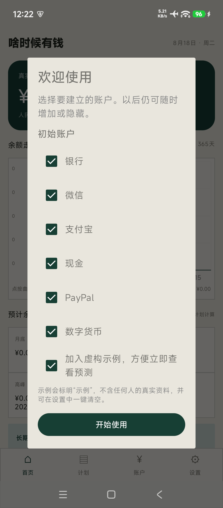
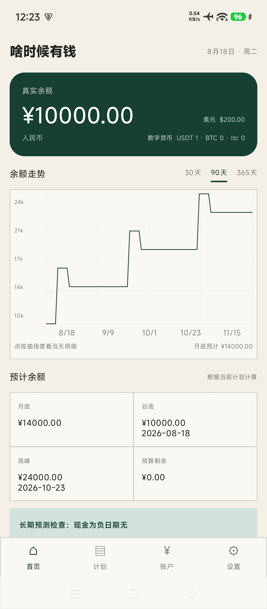
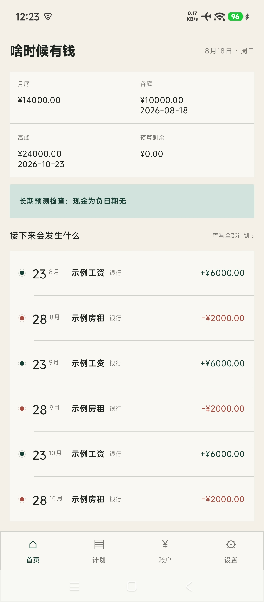
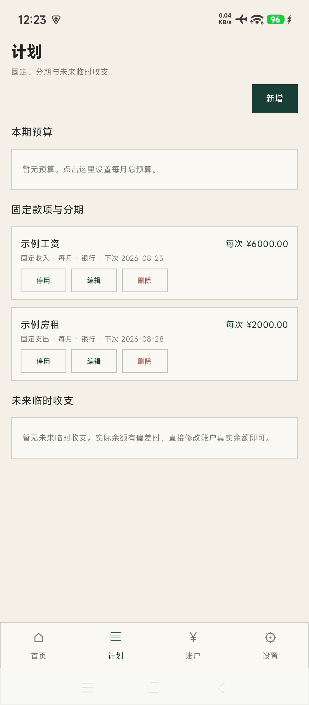
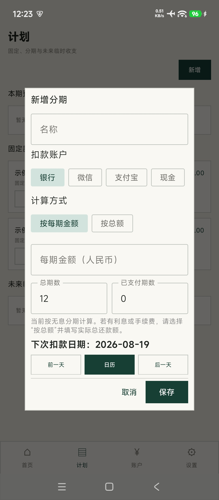
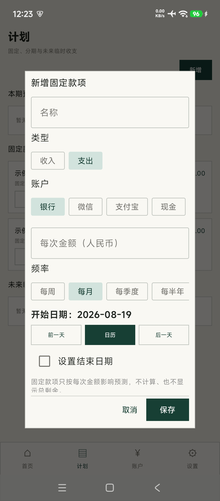
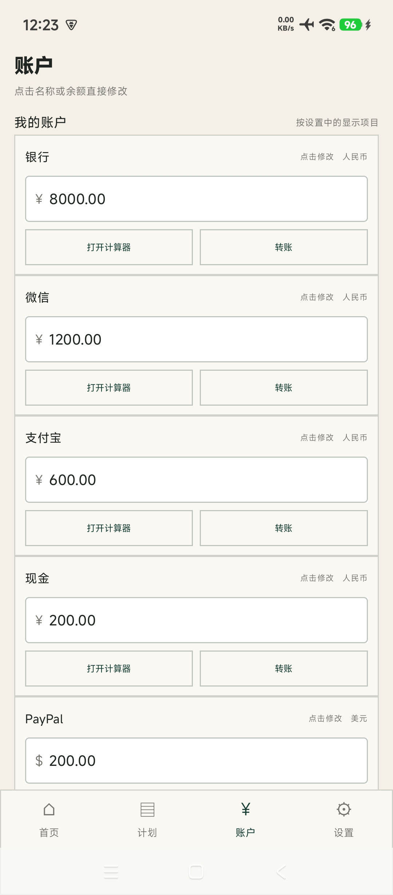
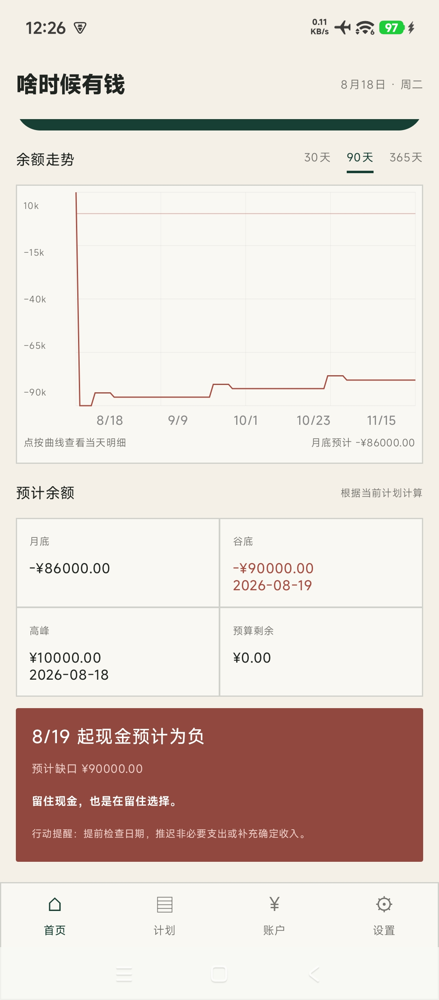

# Show Me the Money（啥时候有钱）

一款简单直观的移动端现金流预测应用。维护账户余额、周期款项、预算和未来临时收支，即可查看未来余额变化。所有数据只保存在本机。

A simple and intuitive cash flow forecasting app for mobile. Maintain account balances, recurring items, budgets, and temporary adjustments to see how cash may change over time.

当前为简易版，仅供简单计算现金状况，暂未包含理财统计功能。开发者：尚宸鸣，使用 OpenAI Codex 协助开发。

后续计划在 2.0 以后逐步加入可选的存款、基金、贷款和财务知识模块。项目已预留模块化功能配置、Android/iPhone 共用预测核心及 iPhone 源码底座，但具体理财数据模型和计算器尚未实现。当前版本将进入相对稳定维护期，短期内以问题修复为主，不承诺频繁增加功能。

项目地址：[github.com/7panni/show-me-the-money](https://github.com/7panni/show-me-the-money)

## 实际界面

以下均为 Android 手机实际运行截图，使用应用内置的虚拟示例金额，不含真实账户或用户数据。

<p align="center">
  
  
  
  
</p>
<p align="center">
  
  
  
  
</p>

## 功能

- 多账户余额：人民币、美元、常用外币与数字货币分开显示，不做汇率换算
- 固定收入、支出按每次金额循环，不显示容易误解的总剩余
- 分期可按每期金额计算剩余总额，也可按总额自动计算每期金额
- 固定收支和分期到期后只入账一次，自动更新对应账户真实余额；未来临时收支仍只影响预测
- 每张账户卡可直接发起同币种转账，支持转账前余额确认和完成后撤销
- 每周、每月、每季度、每半年、每年计划
- 周期预算和未来临时收支
- 30、90、365 天余额预测与可查看数值的走势图
- 每月预算默认从 1 日开始，可在设置中改为 1—28 日
- 现金风险提示语可关闭，或选择在风险期间保持不变、每天更换
- JSON 完整备份与恢复
- 首次启动默认只提供虚构的工资、房租示例，其他内容按需添加
- 每个账户可单独选择是否在账户页显示；默认提供银行、微信、支付宝、现金、PayPal 和数字货币
- 账户名称和真实余额均可原地修改并自动保存；账户卡另有应用内计算器
- 计划卡直接显示下次发生日期；分期显示剩余期数和剩余总额
- 在现金可能为负、分期和转账场景显示可关闭的财务常识

## 当前平台与架构

- 当前可安装版本：Android
- `app`：Android 界面与 Room 本地数据库
- `shared`：Android/iPhone 共用的整数金额、日期和现金流预测核心
- `iosApp`：iPhone SwiftUI 源码底座；待具备 Xcode 与 Wi-Fi 环境后继续构建和测试

## 隐私

所有数据仅保存在设备本地。首次启动的可选示例均明确标注为虚构示例。本仓库不包含任何真实账户余额、备份或测试数据库；安装包仅通过 GitHub Releases 发布。

## 构建

需要 JDK 17 和 Android SDK。仓库自带固定为 Gradle 8.7 的 Wrapper：

```bash
./gradlew :shared:testDebugUnitTest :app:testDebugUnitTest :app:assembleDebug
./gradlew :app:assembleRelease
```

`release` 会启用代码压缩和无用资源移除。测试发布包暂用调试签名，可直接侧载；正式商店版需另建发布密钥。

Apple 目标默认不初始化，以免 Android 构建下载 Apple 相关工具；有 Xcode 后使用 `-PenableIos=true` 开启。

后续财务知识、复杂借贷与理财计算规划见 [未来路线图](docs/ROADMAP.md)。

## 许可证

本项目采用 [MIT License](LICENSE)。
